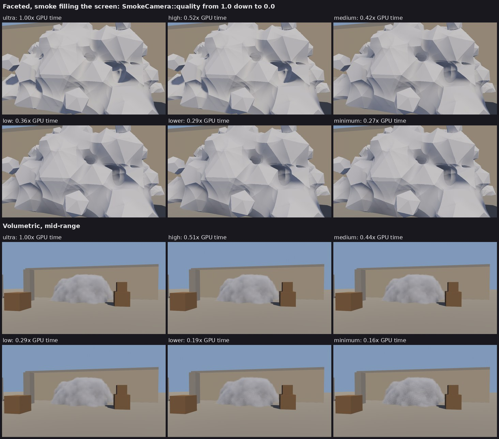
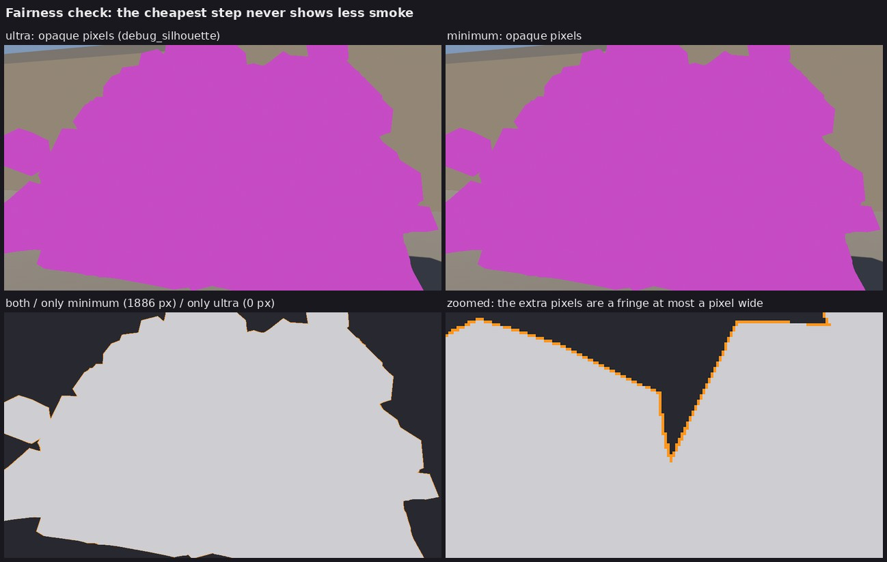

# How Smokescreen works

The README covers using the plugin; this is how it works inside, and why.

## Why this design

There are three realistic ways to draw space-filling smoke in Bevy:

| Approach | Strengths | Why not |
|---|---|---|
| Lit particle billboards (the traditional approach) | Cheap at a distance, simple | Overdraw explodes exactly when you're inside or behind the smoke. Can't respect walls or doorways. Bullet holes are faked. |
| Bevy's built-in `VolumetricFog` + `FogVolume` with a 3D density texture | No custom rendering | Each volume is its own **full-resolution** raymarch of `step_count` steps, per volumetric light. There's no reduced-resolution mode and no history. Cost scales with screen coverage × number of smokes × lights. |
| **Voxel flood fill + reduced-resolution raymarch (this crate, CS2-style)** | Cost is bounded by covered pixels at reduced resolution × steps, and the steps exit early in dense smoke. One pass covers all smokes. Interacts with geometry. Gameplay queries reuse the same data. | More code (it's written) |

The core trick is to put each piece of work where it runs the fewest times:

```
               once per grenade                     only while changing           every frame, per camera
┌──────────────────────────┐   ┌────────────┐   ┌─────────────────────────┐   ┌──────────────────────────┐   ┌──────────────────────────┐
│ 1. Flood fill (core)     │ → │ 2. Light + │ → │ 3. Bake density + light │ → │ 4. Raymarch, low res,    │ → │ 5. Depth-aware upsample  │
│ ~0.2 ms a tick, 14 ticks │   │ upload     │   │ per voxel, compute      │   │ covered screen rect only │   │ + hardware blend         │
└──────────────────────────┘   └────────────┘   └─────────────────────────┘   └──────────────────────────┘   └──────────────────────────┘
```

The crystal style only shares step 1: its puffs are ordinary meshes.

## 1. Flood fill (`smokescreen`, a little each tick)

A Dijkstra expansion runs over a 48×24×48 grid of 0.3 m voxels (14 × 7 × 14 m) around the source. It uses the 26-neighbourhood with Euclidean step lengths, so the cloud is round in the open and follows geodesic paths around corners. Diagonal moves are rejected if they would squeeze between two walls.

It stops after `volume / voxel³` voxels, about 3,300 for the default 90 m³. A smoke in a corridor therefore runs further than one in the open, as in CS2. For comparison, community reverse-engineering puts CS2's grid at 32³ cells of 20 units (roughly 0.5 m); 0.3 m here gives crisper walls and doorways for about 2.3× the voxels.

Shape controls:
- Moving up costs 1.4× and moving down 0.9×, so the cloud is a wide dome that pours off ledges.
- Low-frequency noise on the step costs makes the outline lumpy.
- A line source starts every voxel along the line at distance 0 (a wall); a box source starts each voxel in the box as far out as it lies across it, so a fog bank fills from the middle and feathers at the edges.

Each voxel stores **when** the smoke reaches it (normalised distance), not whether it's filled. The GPU animates the growth front from that value, so nothing is re-uploaded while the smoke blooms.

The fill also records which voxels the level says are solid; it asks about every neighbour of every filled voxel. Solid voxels hold no smoke, so plain trilinear filtering would fade the smoke out over the last voxel before every wall and floor: a see-through layer up to a voxel and a half deep along every surface, which the noise then frayed to nothing. Instead, every sample averages only the open voxels around it (in the core, `Grid::sample_distance` for distances and `VolumeField::density` for densities; on the GPU, filtered density divided by a filtered open mask). Smoke pressed against a wall stays as dense as the smoke in front of it, right up to the middle of the first solid voxel, in the rule and the picture alike.

A voxel counts as solid once a wall reaches a little way into it (3 cm with `BoxObstacles`, so that thin walls always block), so on its own that would stop the smoke at the middle of a voxel the wall only clips: up to 12 cm short of the wall, a see-through layer along it. The fill therefore pads such voxels. After the spread it asks the level whether the centre of each solid voxel next to the smoke is inside the wall (`Level::is_inside`). A *clipped* voxel, whose centre is open air, takes the smallest fill distance of the filled voxels beside it (and then, for the edges and corners where walls meet floors, of padded ones, towards the inside of the wall only), and samples treat it as open (`occupancy::PADDED`). The smoke then reaches into the wall, where it is hidden.

Padding must never let smoke show past a wall. Samples near a padded voxel read its 26 neighbours, so it is padded only if they are all on the smoke's side: inside the wall, filled or clipped, or open air the smoke could reach without crossing a wall, by face steps through open voxels within the 3×3×3 block, from the filled ones (around the edge of a door frame, say). And none may be a clipped voxel that itself has open air beside it the smoke can't reach: across a thin wall that leans, a filled voxel can touch one along an edge while its centre is past the wall. Air past a wall thinner than a voxel fails these tests, so against thin walls the smoke still stops at the middle of the first solid voxel: up to 12 cm can stay clear in front of such a wall, and as much can show past it, as before (`tests/walls.rs` checks walls at several angles and leaning over a floor; a sweep of 1,500 thin walls at random angles found none with more smoke past it than before). Walls at least a voxel thick are filled right up to wherever they sit on the lattice, and so are floors and the edges where they meet walls.

A level made of surfaces (meshes voxelised by `VoxelObstacles::from_triangles`) is hollow inside, which would look like open air past a thin wall. So the voxels near its surfaces get winding numbers, counted as signed crossings down the up axis along each column of voxel centres: a voxel whose centre is inside a mesh facing outwards is inside for `is_inside` even when no surface passes through it, and the fill treats such *hollow* voxels next to padded ones as solid. Overlapping meshes (a wall sunk into a floor) add up and sheets facing both ways cancel out. A single sheet facing up counts as solid underneath, as terrain or a ground plane is; a vertical sheet with nothing behind it (a partition made of a plane) has no inside, nor has a mesh facing inwards, so smoke stops short of those as before rather than leak.

`VoxelObstacles::from_level` asks its source both questions, at the very points a fill asks them (both compute a voxel's centre from its lattice index), so voxelised levels give exactly the source's clouds. Padding costs about 7% more fill work in a level full of walls off the lattice (instruction counts) and nothing for faceted and crystal clouds, whose puffs are clipped by the fill's region instead.

The fill is a state machine that can stop after any small step and pick up where it left off, which is how it keeps to a per-tick budget (`Config::fill_budget`, work units of about 10 ns). A piece of work too big to split waits for the start of the next tick rather than overrunning this one. If a fill would still be running when its cloud starts, the budget grows to spread the rest evenly over the ticks left. The finished cloud is the same however the work was split.

Faceted and crystal clouds add a halo, two distance transforms, puff seeding and binning to the same state machine. Crystal puffs are sized at seeding so that, at their biggest and in any orientation, they stay inside the space the fill may occupy: they are never clipped when drawn, so they must never poke through a wall.

## 2. Lighting and upload (volumetric and faceted, once per grenade)

Once a fill is done, `bevy_smokescreen` works out per voxel whether the level hides the sun (one ray) and the sky (six rays), casting from every second voxel and smoothing in between. That is what makes indoor smoke darker. It takes 1–2 ms on the async compute pool, and the cloud is drawn fully lit until the result arrives, usually a frame later.

The grid is 48×24×48 RGBA8 (distance, sun visibility, sky visibility, wall clip), 221 KB, plus an R8 open mask (55 KB). They go into one slot of 3D texture atlases with up to 32 slots. Each slot keeps an empty border, so trilinear filtering never bleeds into the neighbouring slot.

## 3. Bake (GPU compute, only for slots that changed)

**Density pass:** per voxel, apply the growth front, the dissolve and every open hole in the core's snapshot. This is the only place holes are evaluated, so a spray of 16 bullet tunnels costs 16 capsule tests per voxel once per frame, instead of per pixel per step. Per-sample hole evaluation is what makes naive implementations slow.

The rule works out density in the same order: density per voxel first, then interpolated between voxels. Each tick the core takes the density of every fill-distance byte once (`DensityTable`, kept while a cloud's growth and dissolve stay the same) and samples interpolate those values over the open voxels, as the sampler interpolates the baked densities. Interpolating distances and then taking the density gives a different answer wherever the density curve bends, most at a cloud's edge, where the picture drew up to six times the smoke such a rule counted. Holes differ: the rule applies them at each sample, exactly, and the bake at each voxel's centre, so the picture's tunnels are smoothed over a voxel.

**Lighting pass:** per voxel, march 10 growing steps towards the sun and 6 upwards through the smoke. It stores single-scattered sun, a multiple-scattering approximation (Wrenninge-style octaves) and ambient occlusion.

Lighting therefore costs per **voxel**, not per **pixel × raymarch step × light step**. For a smoke covering a good part of a 1080p screen that is tens of times fewer samples than marching shadow rays from every pixel.

A smoke that is fully grown and untouched (no holes, not fading, sun not moving) is skipped entirely, so steady smokes cost nothing here. In a smoke that is changing, a voxel whose neighbours all lie outside the box the smoke occupies at this tick (`CloudState::active`) is cleared instead of lit: no sample that reads it holds smoke, so its lighting is never seen. While a cloud blooms or fades that is most of its grid.

## 4. Raymarch (GPU compute, reduced resolution)

- **Screen rectangle:** the CPU projects the box each smoke occupies at this tick (`CloudState::active`: the voxels before the growth front and not yet eaten by the fade, padded by the voxel a sample reads around it) and dispatches only the rectangle they cover. While a smoke blooms and fades that box is much smaller than the smoke's whole grid. Distant smokes cost a few thousand rays, and no smoke on screen means no passes at all.
- **Ray setup:** each ray intersects every smoke's whole box (ALU only) and marches front to back only inside those intervals, clamped to the scene depth. Gaps between smokes are jumped over. A ray's samples lie on a sequence fixed by the ray alone, `t_k = u0·r^k − 1/g` with `u0 = jitter·b + 1/g` and `r = 1 + b·g` (`b` the step near the camera, `g` its growth per metre): the step `b·(1 + t·g)` started at the camera rather than at a smoke's box. The first sample at or past any distance is then one logarithm away, so a ray starts where it enters the box the smoke occupies at this tick, without any sample moving as that box changes tick by tick, and empty samples skip a voxel at a time along the same sequence. Skipped samples count against the step budget as they did, so a tier reaches as far as it did. (Jumping the 4³ bricks the rule skips was tried as well and cost more than it saved on an Apple M4: the lookups outweigh the iterations in a loop that runs in lockstep.)
- **Per step:** one fetch of the baked volume (density + all lighting), one of the open mask (density is divided by it, see above), plus one or two fetches of a tiling 64³ noise texture. The noise carves the coarse voxels into billows and wisps; with `SmokeSettings::noise_within_rule` set to `Capped`, a ray stops fetching it once it has taken all the cloud it may (see "The picture against the rule"). The second noise fetch only happens on thin edges.
- **Early exits:**
  - stop at 1 % transmittance, so inside dense smoke a ray ends within about half a metre;
  - skip a voxel at a time through empty space;
  - lengthen steps with distance;
  - take a fast path with the smoke's data hoisted out of the loop when a ray crosses only one smoke.
- **Jitter and integration:** the start of each ray is jittered with interleaved gradient noise. Integration uses Hillaire's energy-conserving formula.

## 5. Composite (full resolution, scissored)

For each pixel, the composite reads the 2×2 smoke texels. If all four are clear it discards before touching depth, which is most pixels.

Otherwise it weights them by bilinear position and by depth similarity to the full-resolution depth, so smoke doesn't bleed across the silhouette of a crate in front of it. The fixed-function blender applies `scene × transmittance + light`, so the scene is never copied.

This runs after the opaque (and transmissive) pass and before the transparent pass, drawing into the multisampled texture when MSAA is on. Glass and particles in front of a smoke therefore draw over it, and TAA, bloom and tonemapping treat the smoke like the rest of the image. A first-person weapon is opaque, so it needs its own camera (see `examples/viewmodel.rs`).

## The faceted style

It reuses the flood fill, timeline, holes and rule, and replaces the density with geometry:

- **Puffs:** the core seeds one puff per ~0.9 m cell of filled voxels, deterministically from the smoke's seed, so every machine has the same puffs. Each is an icosahedron, dodecahedron, octahedron or cube that tumbles slowly, pops in when the growth front reaches it and shrinks away as the smoke dissolves.
- **Surface:** the puffs' signed distance fields merged with a polynomial smooth minimum (`blend`), so neighbouring puffs fuse into one lumpy cloud while each keeps flat facets.
- **Walls:** the surface is clipped to the fill (plus a small `overhang`), so it never pokes through a wall or around a door jamb further than the volumetric smoke would.
- **Holes:** bullets cut hexagonal tunnels and HE grenades an icosahedral cavity, with the same timings as the volumetric style.
- **Rule:** the core evaluates the same field on the CPU (`FacetRule::Exact`), or only each puff's inscribed sphere (`FacetRule::Core`), which never blocks a line the picture leaves clear. `occlusion` under the exact rule sphere-traces the field. `blocks_sight` first bounds the amount with exact chords: the blended surface lies at or below the plain minimum of the puffs, so it contains every puff's hard polyhedron (clipped to the ball of `Puff::room`, inside the fill's space, and minus a capsule around each hole); and a chain of smooth minima lies at most the blend radius below that minimum, so the surface lies inside the polyhedra grown by the blend radius. A line whose lower bound reaches the threshold is blocked, one whose upper bound can't is clear, and only the rest (lines within 2 cm of the threshold) are traced. The trace places each surface crossing to about `MIN_STEP` (5 mm), so the 2 cm keep the two answers apart unless a line crosses the surface many times; a test checks them against each other on random lines through clouds with holes (`blocks_sight_matches_occlusion`; 730,000 lines with `--ignored`). Grown clouds then cost about what the core rule costs, half a volumetric check.

Rendering is sphere tracing against that field:

- only the screen rectangle covered by what the puffs occupy at this tick is dispatched: each puff's bounding sphere plus the blend radius (`CloudState::active`), padded by how far blended puffs can reach past that ((corner ratio − 1) × blend), so the picture never draws less than the rule counts;
- a uniform grid of bins lists the puffs that can reach each cell;
- far from the surface a step only tests bounding spheres, and polyhedra, the wall clip and holes are evaluated only near it;
- normals are analytic, so facets are exactly flat;
- shadows are traced through the puffs (or read from the baked volume at lower dial steps);
- a ray that runs out of steps is drawn as smoke ("fails closed").

At reduced resolution the work is split so that only pixels that need it are traced at full resolution:

1. **Coarse pass:** one ray per 2×2 or 4×4 block. It records the hit distance, the normal, the expensive part of the lighting (shadow ray, occlusion) and how near it came to any surface.
2. **Classify:** each pixel looks at its four surrounding coarse samples. If they prove the pixel is inside one facet, or on a convex edge between two (the surface is then the farthest of their planes), it is shaded right there, with a per-pixel normal and the samples' lighting. Empty pixels are cleared. Everything else goes into a queue.
3. **Retrace:** the queue (silhouettes, creases between puffs, shadow edges) is traced and shaded at full resolution, one invocation per pixel via an indirect dispatch. It starts just in front of the surface and reuses the coarse lighting where the samples on the same facet agree. Keeping the expensive pixels together stops them holding up cheap ones in the same SIMD group.
4. **Composite:** the result is blended over the scene.

Reduced resolution only pays while puffs are big on screen, so the divisor steps down by itself once the nearest smoke's puffs span fewer than about 30 pixels per step. At 1080p with a 45° field of view, the 2×2 steps trace at full resolution beyond ~15 m, and the 4×4 steps drop to 2×2 beyond ~8 m.

Why faceted costs more than volumetric, though its edges are hard: the puffs melt into each other, so the surface only exists as a formula that blends about ten nearby puffs, each turned to its current angle and tested against up to twenty faces; the shape changes every tick, so it can't be baked; and a hard edge has to be found exactly (a soft one forgives a coarse sample). The crystal style drops the melting, and with it most of the cost.

## The crystal style

- **Puffs:** the same seeding as faceted, without the blend, each sized to fit inside the fill's space at its largest.
- **Drawing:** one entity per puff with a flat-shaded mesh built from the same face planes the core checks against (`polyhedron_mesh`), drawn double-sided by Bevy's PBR renderer. Each frame the puffs are moved, scaled, shown and hidden to match the core's snapshot at the drawn tick. They are lit by every Bevy light, cast and receive shadows, and write depth, so volumetric smoke and everything else sorts against them correctly.
- **Holes:** a puff shrinks until its corners clear each open hole's core, so a shot knocks crystals out of the way along its path and they grow back as the hole closes. Picture and rule use the same puff sizes.
- **Rule:** the exact length of the segment inside the union of the polyhedra, a bin cell at a time (`smokescreen::chords`): a bounding-sphere test, then a slab test per pair of faces. With `sight_threshold = 0` (blocked on any contact), what players see is exactly what blocks.

## The performance dial

Every camera has one number, `SmokeCamera::quality`, from 0 (cheapest) to 1 (best) in six steps, applied to whichever of the volumetric and faceted styles is on screen (crystal smoke is ordinary geometry and has no dial):

```rust
commands.spawn((Camera3d::default(), SmokeCamera { quality: 0.6, ..default() }));
// LOW / MEDIUM / HIGH / ULTRA are 0.2 / 0.4 / 0.8 / 1.0.
```

To hit a frame-time target instead, give it a budget:

```rust
app.add_plugins(bevy::render::diagnostic::RenderDiagnosticsPlugin); // GPU timings
commands.spawn((Camera3d::default(), SmokeCamera::budget(1.5)));      // ms of GPU time
```

The budget controller re-decides the step every frame:

- It predicts each step's cost from how much of the screen the smokes cover this frame, times a per-step factor, times a scale it learns from the measured GPU time of the smoke passes. It reacts the moment a smoke fills the screen, not two frames later when the slow frame is measured.
- It drops steps immediately and climbs back one step at a time, after the next step has fitted with room to spare for 30 frames, so it doesn't oscillate.
- `quality` becomes the ceiling: `SmokeCamera { quality: 0.8, budget_ms: Some(1.5), ..default() }` never goes above "high".
- The `SmokeQuality` component on the camera reports the step in use, the measured and predicted milliseconds and the coverage, for HUDs and logs.
- Without GPU timestamp support it warns once and holds a cautious step.

In the demo's scripted test (`SMOKE_DEMO_SCRIPT=budget`), the camera walks from 24 m into a smoke and back out. With the faceted style and a 250 ms budget on the software rasteriser, 11 of 750 frames were over. One of them was a one-off shader compile, which that rasteriser counts as GPU time. The other 10 were at most 17 % over, all while the camera was moving. With the volumetric style and a 40 ms budget, 6 of 734 frames were over, by at most 13 %.

To pin individual knobs instead, set `SmokeCamera::facets` or `SmokeCamera::volumetric` to a `FacetQuality` / `VolumetricQuality`.

### What each step does



*The pictures, and the costs relative to ultra written on them, are from the software rasteriser this was first built on, at 960×540. The table has an Apple M4's.*

| Step (`quality`) | Faceted | Cost¹ | Volumetric | Cost² |
|---|---|---|---|---|
| ultra (1.0) | full resolution, traced shadows and occlusion | 31.2 ms | full resolution, 128 steps of 0.07 m | 1.33 ms |
| high (0.8) | coarse 2×2, traced shadows and occlusion | 15.0 ms (0.48) | ⅔ resolution, 96 steps | 0.88 ms (0.66) |
| medium (0.6) | coarse 2×2, baked shadows, traced occlusion | 11.1 ms (0.36) | ½ resolution, 72 steps | 0.69 ms (0.52) |
| low (0.4) | coarse 2×2, baked lighting | 10.2 ms (0.33) | ½ resolution, 48 steps | 0.59 ms (0.44) |
| lower (0.2) | coarse 4×4, baked lighting | 8.0 ms (0.26) | ¼ resolution, 40 steps | 0.56 ms (0.42) |
| minimum (0.0) | coarse 4×4, baked lighting, looser hit tolerance | 7.9 ms (0.25) | ¼ resolution, 28 steps | 0.48 ms (0.36) |

¹ With the smoke covering two-thirds of the screen; in brackets, relative to ultra. At mid-range the reduced resolutions don't apply (see above) and the steps cost 7.3 / 5.2 / 4.0 / 3.5 / 3.4 / 3.4 ms (1.0 / 0.71 / 0.54 / 0.49 / 0.47 / 0.46).
² With the smoke at mid-range. Close up, covering two-thirds of the screen, the steps cost 5.9 / 3.1 / 2.0 / 1.8 / 1.1 / 1.0 ms (1.0 / 0.52 / 0.34 / 0.29 / 0.18 / 0.17).

What the smoke adds to a 1920×1080 frame with MSAA on an Apple M4, from the demo's tier sweep (`SMOKE_DEMO_SCRIPT=tiers`), the median of five runs. Metal's GPU timestamp queries lose the device, so there the sweep times whole frames instead, each waiting for the GPU, and subtracts the same view without smoke; that counts the CPU's share of drawing the smoke too. On the software rasteriser, the faceted steps cost 1.00 / 0.52 / 0.42 / 0.36 / 0.29 / 0.27 of ultra close up, and the volumetric ones 1.00 / 0.51 / 0.44 / 0.29 / 0.19 / 0.16 at mid-range. Run the same sweep on your target hardware. The budget controller only uses ratios like these to guess what a step change will save; it learns the absolute cost from your GPU.

## Fairness

Two kinds are kept apart here. Between players, everyone must see the same smoke, whatever their step of the dial: this is what competitive play needs. Against the rule, the picture should agree with `blocks_sight`, which matters when the rule decides what a server sends, what bots see or what abilities reach (see "The picture against the rule" below).

A step may change how precisely smoke is drawn, never its shape. The shape decides who can see whom, so a player on the cheapest step must not see through smoke that a player on the best step can't. Where a step cuts corners, it errs towards more smoke:

- **Silhouettes:** every faceted pixel that could be on or near a silhouette is traced again at full resolution. A coarse ray notices any surface a full-resolution pixel could show, so pixels are only skipped or interpolated when that is provably safe.
- **Hit tolerance:** a looser tolerance (cheaper steps) can only thicken a silhouette, by at most that many pixels.
- **Step budgets:** a faceted ray that runs out of steps is drawn as smoke.
- **Volumetric:** the steps change resolution and step length, never the density. Gameplay queries run in `smokescreen` and don't depend on the dial.

`tools/fairness.py` checks this on the tier sweep's silhouette masks (`SmokeSettings::debug_silhouette` draws faceted and crystal smoke flat magenta). Across three distances and all six steps, no pixel that is smoke at "ultra" is missing at any cheaper step, beyond the one-pixel anti-aliasing band. The cheapest step adds a fringe at most one pixel wide (1,886 extra pixels on a 960×540 frame filled with smoke):



On an Apple M4 at 1920×1080 the sweep finds the same: nothing missing beyond the band at any step or distance, and close up the cheapest step adds 4,370 pixels around 1.3 million of smoke.

Volumetric smoke has no hard silhouette, so for it the demo's `agreement` run at each step (`SMOKE_DEMO_TIER`) shows how much of the scene shows through every pixel, and those are compared with the best step's. Away from the smoke's outline, under 1 % of its pixels differ by more than a tenth, either way: the noise, sampled at fewer and longer steps, falls a little differently. The most that let over 30 % more through is 121 of 314,514 (close up, the cheapest step, a grown cloud), and 29 of 62,217 halfway through the fade.

### The picture against the rule

`tools/agreement.py` compares the picture with the core, pixel by pixel, from four places (`SMOKE_DEMO_SCRIPT=agreement`, with `SMOKE_DEMO_STYLE=faceted` or `crystal`): for the segment from the eye to the scene behind each pixel, it asks the core for `occlusion` and `blocks_sight` at the default 0.8 m. Results on 960×540 frames on an Apple M4, in the demo's current level (the low wall now stands in front of the smoke), not counting the one-pixel band along silhouettes and depth edges:

| View | Style | Smoke drawn (pixels) | Touched by cloud, drawn clear | Drawn, touches no cloud | Blocked by the 0.8 m rule, drawn clear | Drawn, 0.8 m rule says visible |
|---|---|---|---|---|---|---|
| far | faceted | 11,687 | 0 | 0 | 0 | 129 |
| front | faceted | 51,274 | 0 | 0 | 0 | 3,389 |
| close | faceted | 336,613 | 0 | 0 | 0 | 55,395 |
| edge | faceted | 85,361 | 0 | 0 | 0 | 9,666 |
| far | crystal | 10,168 | 0 | 0 | 0 | 97 |
| front | crystal | 42,451 | 0 | 0 | 0 | 2,036 |
| close | crystal | 262,399 | 0 | 0 | 0 | 34,921 |
| edge | crystal | 73,970 | 0 | 0 | 0 | 11,003 |

The software rasteriser gave the same zeros in the old level.

Both pictures match the core's surface exactly (the two "touch" columns): with `sight_threshold = 0`, what players see is what blocks. With the 0.8 m threshold the picture never shows through anything the rule blocks, but it draws thin edges and corners (less than 0.8 m of cloud) as solid smoke that the rule, and so a server or a bot, sees through. See `ROADMAP.md`.

Volumetric smoke is soft, so for it the demo draws how much of the scene shows through each pixel (`SmokeSettings::debug_transmittance`, with tonemapping off), and the tool compares that with the rule along the same segments. Without the noise (`SMOKE_DEMO_NOISE=0`) the picture is the coarse density the rule integrates. It is opaque wherever the rule blocks, and the amount of cloud it implies, −ln(transmittance) / extinction, agrees with the rule's to within 1 % halfway through the fade for segments through more than 0.05 m of cloud, and to within 10 % on a grown cloud. The rest is the march's skip through empty space: where the filtered density is under 0.002 it moves on at least a voxel, which can step over the start of a cloud's edge. With the skip turned off the two agree to within 0.5 %. (Past −ln(0.01) / extinction, 0.66 m by default, the march draws the smoke opaque, so the picture says no more.)

The noise only ever thins the smoke, so by default the picture shows through some of what the rule blocks: the fewest pixels of a grown cloud, the most once the fade adds to the erosion. Players all see the same thinning, so between them that is fair; a server or bots that use the rule see less than players there. `SmokeSettings::noise_within_rule` stops it in one of two ways. The rule blocks from 0.8 m of cloud and the picture is opaque from 0.66 m, and the two use that gap differently:

- **`Capped`:** the noise may take at most 0.14 m from any ray, shared front to back by every smoke the ray crosses; past that the ray draws its smoke as the rule counts it, and stops sampling the noise, which makes it cheaper. No march that goes front to back can keep more noise with that promise: the noise never adds smoke, so once more than 0.14 m is gone, a line that turns out to hold 0.8 m can't be drawn opaque any more. Where a line holds more cloud than that, the billows are shallower, and a fading cloud stays a pale, smooth dome where the rule still blocks.
- **`Filled`:** the noise runs freely, and the march also adds up the cloud the rule counts along the ray, with the light it would scatter. At the end, from 0.66 m of that cloud to 0.8 m, the opacity the noise took is filled back in behind what was drawn, in that light. The billows stay; a fading cloud stays a textured dome with a crisp outline where the rule still blocks. The extra sums cost about 10 % close up at the top steps.

Either way the stretches the empty-space skip steps over count as cloud the noise took, as a ramp from nothing up to the smoke the skip lands in, and thin smoke (wisps, edges, silhouettes) keeps all its noise. Each is compiled in only when chosen. Pixels the rule blocks that let more than 1 % or 30 % of the scene through, away from edges, at the best step (`Capped` and `Filled` alike):

| View | Blocked, grown | More than 1 % / 30 % show through | `Capped` or `Filled` | Blocked, 16.5 s | More than 1 % / 30 % | `Capped` or `Filled` |
|---|---|---|---|---|---|---|
| far | 9,996 | 116 / 34 | 0 / 0 | 3,078 | 777 / 580 | 0 / 0 |
| front | 43,444 | 3,119 / 1,063 | 0 / 0 | 13,076 | 4,767 / 3,345 | 0 / 0 |
| close | 277,193 | 36,173 / 15,377 | 0 / 0 | 71,268 | 34,006 / 22,661 | 0 / 0 |
| edge | 69,729 | 7,826 / 1,717 | 0 / 0 | 11,973 | 6,945 / 3,836 | 0 / 0 |

With `Capped`, every other step of the dial gives the same zeros, grown, 0.8 s into the bloom and at 16.5 s; what is left lies in the one-pixel band along the edges of the blocked area, at most 474 pixels (the cheapest step, far away, where the march runs at a quarter of the resolution). `Filled` gives zeros down to the "low" step; at the two cheapest, a few pixels just inside the edge of the blocked area let a little through (up to 16 by more than 1 %, 12 by more than 10 %, none by more than 30 %), as the quarter resolution blurs its sharper fill. With the setting off the picture is what it was, pixel for pixel, at the same cost. Marching what the skip steps over instead of charging it (going back whenever a jump lands in smoke) made the picture without the noise agree with the rule to within 0.5 %, but cost 12–17 % close up at the top two steps on an Apple M4 and changed nothing visible with the noise on, which erodes that thin smoke anyway.

## Cost and memory

Rough cost model per camera (volumetric, "high" step, 1080p):

- **Raymarch:** `covered pixels / 2.25 × steps actually taken × ~2.5 fetches`, starting at the box the smoke occupies.
  - A smoke covering 40 % of the screen, seen from outside: ~370 k rays × ~25 steps (dense smoke exits early) ≈ 23 M texture fetches.
  - Standing inside one is cheaper per ray: it goes opaque within ~0.5 m.
  - Thin, dissolving smoke is the most expensive case and is capped by `max_steps`.
- **Composite:** up to 9 fetches per pixel inside the scissor rectangle, most discarded after 4.
- **Bake:** ~55 k voxels × ~18 samples per changing smoke, about a million fetches each, less the voxels around the box the smoke occupies (most of the grid while it blooms or fades), and nothing for smokes that aren't changing.
- **CPU:**
  - per tick, the core's fill budget (about 0.2 ms while a fill is running);
  - per grenade, 1–2 ms of sun and sky visibility rays on a worker thread (not for crystal);
  - per frame, a few microseconds of bookkeeping, the snapshot of the tick being drawn (microseconds for volumetric smokes, about 20 ns per faceted or crystal puff), and moving the crystal puff entities;
  - at startup, ~0.6 s of CPU time for the noise texture, spread over all cores on a background thread while the window and GPU device are created.

The faceted style costs more per covered pixel than the volumetric one (it is sphere tracing polyhedra rather than sampling a texture): roughly 3–5× at the same dial step on the software rasteriser, 5–8× on an Apple M4. Its cost also depends on distance: close up, big flat facets are mostly shaded from the coarse samples; at mid-range many small facets mean many silhouettes and creases. Crystal clouds are a few hundred small meshes each: a few thousand triangles, plus shadow-map draws.

On an Apple M4 at 1920×1080 the volumetric style costs 0.3–0.5 ms for a distant smoke and 1–6 ms for one covering two-thirds of the screen, depending on the dial step (see the table above and the README's Performance section); a desktop GPU should do better. **Measure it on your hardware.** Where the GPU supports timestamp queries (not Metal, so far), the demo HUD shows per-pass GPU timings from Bevy's `RenderDiagnosticsPlugin`:

- `smoke_bake`;
- volumetric: `smoke_march`, `smoke_composite`;
- faceted: `smoke_facet_trace` at full resolution, or `smoke_facet_coarse`, `smoke_facet_classify`, `smoke_facet_retrace` and `smoke_facet_composite`.

You can read the same diagnostics in your own game; `bevy_smokescreen::quality::{VOLUMETRIC_PASSES, FACET_PASSES}` list the names.

**Memory:** about 24 MB for the atlases and noise with the default 32 slots (lower `Tuning::max_clouds` for less), plus about 10 MB of faceted puff buffers. Per camera, add:
- volumetric: one RGBA16F buffer at smoke resolution (7 MB at 1080p and ⅔ resolution);
- faceted, at reduced resolution: a full-resolution RGBA16F layer (16 MB at 1080p), the coarse samples (8 MB at 2×2), and a retrace queue of 4 bytes per pixel shared by all cameras (8 MB).

Set `temporal_jitter: true` when the camera uses TAA. The jitter then changes every frame and TAA averages it into a smoother result than a higher step count would give.

## References

- Valve's CS2 announcement of dynamic volumetric smokes (reproduced by Gematsu): https://gematsu.com/2023/03/counter-strike-2-announced-for-pc
- CS2 smoke entity schema (`m_VoxelFrameData`, `m_nRandomSeed`): https://s2v.app/SchemaExplorer/cs2/client/C_SmokeGrenadeProjectile
- Community reverse-engineering of CS2 smoke voxels: https://memorin.app/mechanics/smoke-voxels
- Garrett Gunnell (Acerola), CS2 smoke recreation in Unity: https://github.com/GarrettGunnell/CS2-Smoke-Grenades
- Activision, Rendering of Call of Duty: Infinite Warfare (froxel volumetrics + lit particles): https://www.activision.com/cdn/research/2017_DD_Rendering_of_COD_IW.pdf
- Hillaire, Physically Based and Unified Volumetric Rendering in Frostbite (2015): https://www.slideshare.net/DICEStudio/physically-based-and-unified-volumetric-rendering-in-frostbite
- Schneider & Vos, The Real-time Volumetric Cloudscapes of Horizon Zero Dawn (2015): https://www.advances.realtimerendering.com/s2015/The%20Real-time%20Volumetric%20Cloudscapes%20of%20Horizon%20-%20Zero%20Dawn%20-%20ARTR.pdf
- Wrenninge, Kulla & Lundqvist, Oz: The Great and Volumetric (2013): https://history.siggraph.org/learning/oz-the-great-and-volumetric-by-wrenninge-kulla-and-lundqvist
- Jimenez, Next Generation Post Processing in Call of Duty: Advanced Warfare (interleaved gradient noise): https://www.iryoku.com/next-generation-post-processing-in-call-of-duty-advanced-warfare/
- Akenine-Möller, Fast 3D Triangle-Box Overlap Testing (2001), for `VoxelObstacles::from_triangles`.
- Bevy `FogVolume` docs: https://docs.rs/bevy/latest/bevy/light/struct.FogVolume.html
